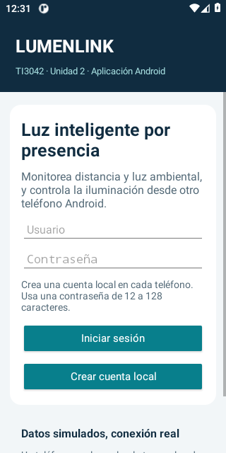
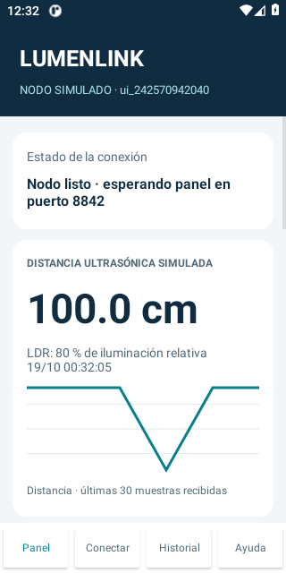
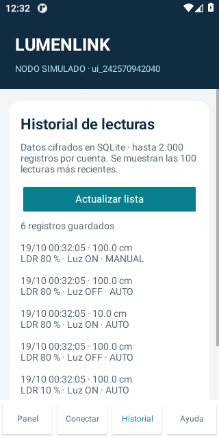
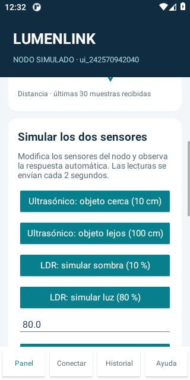

# LumenLink para la Unidad 2 de TI3042

Repositorio del proyecto: [dublind/LumenLink-u2](https://github.com/dublind/LumenLink-u2).

Aplicación Android en Kotlin que continúa el prototipo de la Unidad 1 descrito por el estudiante: **sensor ultrasónico, fotoresistencia LDR y una luz**. Un teléfono funciona como panel y otro simula el nodo IoT. La comunicación Wi-Fi entre ellos es real; los valores de sensores y el actuador son simulados para esta unidad.

En automático se enciende la luz si **distancia ≤ umbral de cercanía O iluminación LDR ≤ umbral de oscuridad**. Se puede activar cada condición por separado. En manual el usuario controla la luz hasta volver a automático.

La LDR mide iluminación, no distancia. Su lectura se representa como un porcentaje relativo: 0 % corresponde a oscuridad y 100 % a mayor iluminación del rango calibrado. No son lux ni una conversión eléctrica sin calibración. La activación por oscuridad/sombra es la interpretación implementada del comportamiento descrito; debe validarse frente al circuito original y con el docente.

Para estudiar el código, empieza por [Organización del proyecto](#organización-del-proyecto).
La preparación del Arduino está en [Integración futura con Arduino](#integracion-arduino), dentro de este mismo manual.

## Instalar y usar

1. Instala `LumenLink-U2.apk` en dos dispositivos Android 8.0 o posteriores. Si Android lo solicita, permite la instalación desde la aplicación con la que abres la APK.
2. Crea una cuenta local en cada teléfono e inicia sesión. Usuario: 3–32 letras, números, punto, guion o guion bajo. Contraseña: 12–128 caracteres. No hay credenciales predeterminadas.
3. Conecta ambos equipos a una red Wi-Fi que permita comunicación entre sus clientes. Se puede usar un punto de acceso; no hace falta Internet para ejecutar la aplicación.
4. En el teléfono B, abre **Conectar → Usar como nodo IoT simulado**. Revisa su IPv4, inicia el nodo y copia la configuración privada.
5. En el teléfono A, abre **Conectar → Usar como panel de control**, pega la configuración y conecta.
6. En **Panel** observa distancia, nivel LDR, modo y estado confirmado de la luz.
7. En el nodo, desplázate a **Simular los dos sensores**: prueba objeto cerca/lejos y sombra/luz. En el panel o el nodo puedes cambiar los umbrales y usar control manual.
8. En **Historial** consulta registros locales y solicita la sincronización de los registros del nodo.

La configuración tiene el formato `LUMEN1|IPv4|puerto|huella|token`. Incluye un token secreto: transfiérela por un medio privado y no la subas a GitHub. Si sales de la aplicación para transferirla, la conexión se detiene. Regresa al nodo e inícialo otra vez antes de conectar el panel. La configuración conserva el token mientras no pulses Detener, cierres sesión, cambies de rol o reinicies la aplicación.

Ambas aplicaciones deben permanecer visibles durante la demostración. El prototipo no ejecuta un servicio permanente en segundo plano. Mantiene la pantalla encendida durante el uso conectado; esto facilita la prueba y aumenta el consumo. Detener la conexión o cerrar sesión invalida el token del nodo.

## Regla de funcionamiento

Valores iniciales propuestos: umbral ultrasónico de 30 cm y umbral LDR de 30 %. Son parámetros de demostración, no valores recuperados del código de la Unidad 1.

| Distancia | LDR | Luz en automático |
|---|---|---|
| Lejos: 100 cm | Iluminado: 80 % | Apagada |
| Cerca: 10 cm | Iluminado: 80 % | Encendida por cercanía |
| Lejos: 100 cm | Sombra: 10 % | Encendida por oscuridad |
| Cerca: 10 cm | Sombra: 10 % | Encendida por ambas condiciones |

La comparación incluye el valor del umbral. Puedes configurar cercanía entre 5 y 200 cm y oscuridad entre 0 y 100 %. La distancia simulada acepta 0–500 cm. Estos rangos pertenecen al simulador y no certifican el rango de un sensor físico específico.

## Abrir el código en Android Studio

1. Descomprime el proyecto en una carpeta corta, por ejemplo `C:\Proyectos\LumenLink`.
2. Selecciona **Open** y abre la carpeta que contiene `settings.gradle.kts`.
3. Usa JDK 17 para Gradle. Instala SDK Platform 35 y Build Tools 35.0.0 si el IDE lo solicita.
4. Permite la descarga inicial de dependencias, espera Gradle Sync y ejecuta el módulo `app`.

```powershell
.\gradlew.bat assembleDebug
.\gradlew.bat testDebugUnitTest lintDebug
```

En macOS/Linux: `sh gradlew assembleDebug testDebugUnitTest lintDebug`.

La APK se genera en `app/build/outputs/apk/debug/app-debug.apk`. Es una compilación de depuración firmada para instalar y demostrar el prototipo académico. Una publicación de distribución necesita su propia configuración y clave de firma.

Para las pruebas Android, conecta un emulador o dispositivo de prueba:

```powershell
.\gradlew.bat connectedDebugAndroidTest
```

## Organización del proyecto

Cada archivo Kotlin contiene **una sola clase y lleva su nombre**, así el nombre del archivo dice qué hay dentro.
La carpeta `core` reúne las reglas y los datos que no dependen de Android; por eso se prueban en el computador.

**Pantallas y servicios Android** (`app/src/main/java/cl/ti3042/lumenlink/`)

| Archivo | Qué hace |
|---|---|
| [MainActivity.kt](app/src/main/java/cl/ti3042/lumenlink/MainActivity.kt) | Pantallas: acceso, Panel, Conectar e Historial. Recibe las acciones del usuario y coordina los servicios. |
| [NetworkEngine.kt](app/src/main/java/cl/ti3042/lumenlink/NetworkEngine.kt) | Conexión TLS entre el panel y el sensor: envía y recibe mensajes y reintenta si se corta. |
| [AppDatabase.kt](app/src/main/java/cl/ti3042/lumenlink/AppDatabase.kt) | Base SQLite: cuentas, bloqueo tras 5 fallos y lecturas cifradas por usuario. |
| [DeviceSecurity.kt](app/src/main/java/cl/ti3042/lumenlink/DeviceSecurity.kt) | Claves en Android Keystore: cifrado AES-GCM de las lecturas y certificado TLS del sensor. |
| [TrendView.kt](app/src/main/java/cl/ti3042/lumenlink/TrendView.kt) | Gráfico de líneas de las últimas lecturas. |
| [LdrBar.kt](app/src/main/java/cl/ti3042/lumenlink/LdrBar.kt) | Barra de luminosidad con la marca del umbral de oscuridad. |

**Reglas y datos** (`app/src/main/java/cl/ti3042/lumenlink/core/`)

| Archivo | Qué hace |
|---|---|
| [LightingController.kt](app/src/main/java/cl/ti3042/lumenlink/core/LightingController.kt) | Regla de la luz: cercanía O oscuridad, umbrales y modo manual. |
| [Reading.kt](app/src/main/java/cl/ti3042/lumenlink/core/Reading.kt) | Una lectura de los sensores y su conversión a JSON. |
| [Frames.kt](app/src/main/java/cl/ti3042/lumenlink/core/Frames.kt) | Envía cada mensaje con su longitud para leerlo completo por la red. |
| [Pairing.kt](app/src/main/java/cl/ti3042/lumenlink/core/Pairing.kt) | El código de conexión que se copia de un teléfono al otro. |
| [PinnedTrust.kt](app/src/main/java/cl/ti3042/lumenlink/core/PinnedTrust.kt) | Acepta solo el certificado cuya huella llegó en el código de conexión. |
| [PasswordHasher.kt](app/src/main/java/cl/ti3042/lumenlink/core/PasswordHasher.kt) | Contraseñas con PBKDF2 y sal, y validación de usuario y contraseña. |
| [HistoryFilter.kt](app/src/main/java/cl/ti3042/lumenlink/core/HistoryFilter.kt) | Opciones de consulta del historial (Todas, Luz ON, Luz OFF, Auto, Manual). |
| [ReadingStats.kt](app/src/main/java/cl/ti3042/lumenlink/core/ReadingStats.kt) | Resumen del historial: promedios, mínimos, máximos y porcentajes. |
| [EnergyCalculator.kt](app/src/main/java/cl/ti3042/lumenlink/core/EnergyCalculator.kt) | Calculadora de consumo y ahorro en kWh y pesos. |

**Pruebas**

| Archivo | Qué comprueba |
|---|---|
| [AccountsAndMessagesTest.kt](app/src/test/java/cl/ti3042/lumenlink/AccountsAndMessagesTest.kt) | Contraseñas, formato de mensajes, código de conexión y lecturas (computador). |
| [LightingControllerTest.kt](app/src/test/java/cl/ti3042/lumenlink/LightingControllerTest.kt) | La regla automática, los umbrales y el modo manual (computador). |
| [TlsIntegrationTest.kt](app/src/test/java/cl/ti3042/lumenlink/TlsIntegrationTest.kt) | Una conexión TLS real con certificado fijado (computador). |
| [HistoryCalculationTest.kt](app/src/test/java/cl/ti3042/lumenlink/HistoryCalculationTest.kt) | Filtros, resumen y calculadora del historial (computador). |
| [DeviceTest.kt](app/src/androidTest/java/cl/ti3042/lumenlink/DeviceTest.kt) | Cifrado, cuentas y conexión en un teléfono o emulador. |
| [UiFlowTest.kt](app/src/androidTest/java/cl/ti3042/lumenlink/UiFlowTest.kt) | Recorre las pantallas reales: registro, sensor, panel, historial y salida. |

**Otros archivos**

| Archivo | Qué contiene |
|---|---|
| [AndroidManifest.xml](app/src/main/AndroidManifest.xml) | Declara la pantalla inicial, permisos de red, icono y tema de la app. |
| [styles.xml](app/src/main/res/values/styles.xml) | Colores y apariencia general de Android. |
| [ic_lumenlink.xml](app/src/main/res/drawable/ic_lumenlink.xml) | Icono vectorial de la ampolleta. |
| [VISTA_PREVIA.html](VISTA_PREVIA.html) | Contenido y simulación para navegador, capturas Android y mapa del código. Se abre con doble clic. |
| [VISTA_PREVIA.css](VISTA_PREVIA.css) | Estilos de la vista web: colores, tamaños, distribución y adaptación a celulares, con secciones comentadas. |
| [README.md](README.md) | Manual único: uso, diseño, pruebas, demostración e integración futura con Arduino. |
| [ENTREGA_AAI.txt](ENTREGA_AAI.txt) | Plantilla para entregar el enlace real del repositorio en AAI. |
| [docs/MOCKUP.svg](docs/MOCKUP.svg) | Dibujo conceptual de las pantallas; no es código de la app. |
| `docs/evidencias/*.png` | Cuatro capturas anteriores: acceso, panel, historial y simulador. Las utiliza la vista previa. |

### Archivos de compilación

Estos archivos permiten que Android Studio y Gradle construyan el proyecto:

| Archivo | Para qué se conserva |
|---|---|
| `settings.gradle.kts` | Define el nombre, los repositorios y el módulo app. |
| `build.gradle.kts` | Fija las versiones de las herramientas de Android y Kotlin. |
| `app/build.gradle.kts` | Define versiones Android, Java 17, identificador de la app y dependencias de pruebas. |
| `gradle.properties` | Configura memoria de Gradle, AndroidX y estilo Kotlin. |
| `gradlew.bat` / `gradlew` | Arrancan Gradle en Windows o en macOS/Linux. Son lanzadores generados. |
| `gradle/wrapper/gradle-wrapper.properties` | Fija la versión descargada de Gradle y comprueba su integridad. |
| `gradle/wrapper/gradle-wrapper.jar` | Ejecutable del lanzador de Gradle. Es binario, no código para estudiar. |
| `.gitignore` | Evita subir cachés, compilaciones y archivos locales al repositorio. |

Las carpetas `main`, `test` y `androidTest` se mantienen porque Android les asigna funciones distintas.
`main` se incluye en la app; `test` se ejecuta en el computador; `androidTest`, en Android.

### Cómo leer el código

1. Empieza por `core/LightingController.kt`: sensores, umbrales y modo manual.
2. Abre `MainActivity.kt` y busca `loginScreen`, `dashboard`, `connection` e `history`.
3. Sigue con `NetworkEngine.kt`, `AppDatabase.kt` y `DeviceSecurity.kt` cuando necesites entender esos servicios.
4. Revisa las pruebas para ver qué resultados se esperan de cada clase.

La compilación con Gradle no pudo completarse en este equipo: Java no está configurado en PATH y
el Java 25 incluido en la extensión de Kotlin fue rechazado por la configuración actual. El proyecto
requiere configurar JDK 17 y el SDK Android indicado arriba antes de volver a compilar y ejecutar sus pruebas.

## Seguridad y continuidad

- Contraseñas derivadas con PBKDF2-HMAC-SHA256, sal aleatoria y 210.000 iteraciones; no se guardan en texto claro ni con cifrado reversible.
- Bloqueo de cuenta durante 30 segundos después de cinco contraseñas erróneas.
- TLS 1.2, verificación de huella SHA-256 y token aleatorio de 128 bits dentro del canal cifrado.
- Lecturas cifradas con AES-256-GCM; clave almacenada mediante Android Keystore.
- SQLite con consultas parametrizadas e historial por usuario. Hasta 2.000 registros, con consulta visual de los últimos 100.
- Datos enviados cada 2 segundos, detección de pérdida y reintentos de conexión del panel cada 3 segundos mientras la aplicación esté visible.
- Sincronización de una instantánea del historial del nodo en páginas de 100, conservando identificadores para evitar duplicados.
- El nodo vuelve a automático al detectar la pérdida del panel y sigue evaluando sus sensores simulados. Salir de la aplicación detiene el nodo.

No constituye certificación ISO ni un control industrial validado. La documentación expone medidas implementadas y sus límites.

## Entrega en AAI

La guía pide un **archivo de texto con el enlace a GitHub del código**, además de la demostración en clase. No exige expresamente un informe formal. El proyecto incluye la justificación, mockup, matriz de cumplimiento y guion para apoyar la evaluación individual.

1. Abre [el repositorio del proyecto](https://github.com/dublind/LumenLink-u2) y comprueba el código **descomprimido**, conservando las carpetas.
2. Usa GitHub Desktop o Git para subir futuras actualizaciones del proyecto.
3. Comprueba que estén `app/src/main`, Gradle, el wrapper, README y documentación.
4. Si el repositorio es privado, concede acceso al docente y verifica que pueda abrirlo.
5. El enlace de `ENTREGA_AAI.txt` ya está completado. Añade tus datos académicos si el docente los solicita.
6. Sube ese TXT a AAI antes de finalizar la clase de evaluación. La guía no recibe entregas por correo.

El archivo `ENTREGA_AAI.txt` contiene el enlace al repositorio. Su carga en AAI sigue pendiente. Debes ejecutar las pruebas de aceptación en tus dos teléfonos y revisar la escala de apreciación, que no fue proporcionada.

## Solución de problemas

Revisa IPv4, red compartida y puerto 8842. Redes de invitados o institucionales pueden aislar a sus clientes. Mantén ambas aplicaciones visibles. Si detuviste o reiniciaste el nodo, copia la configuración vigente. Comprueba la fecha del teléfono para validar el certificado, cuya vigencia es de 2020 a 2040. No abras puertos del router hacia Internet para esta actividad.

La aplicación solo declara permisos de red. No necesita cámara, ubicación, contactos ni acceso al almacenamiento compartido. `FLAG_SECURE` protege las ventanas frente a capturas convencionales; para la clase puedes mostrar el funcionamiento en vivo.

## Documentación reunida en este manual

- [Diseño y justificación](#diseno-y-justificacion)
- [Cumplimiento y pruebas manuales](#cumplimiento-y-pruebas)
- [Guion de demostración](#guion-demostracion)
- [Integración futura con Arduino](#integracion-arduino)
- [Resultados de la validación anterior](#validacion-anterior)
- [Mockup visual](docs/MOCKUP.svg)

Fuentes técnicas: [AGP 8.7](https://developer.android.com/build/releases/agp-8-7-0-release-notes), [criptografía Android](https://developer.android.com/privacy-and-security/cryptography), [SQLite](https://developer.android.com/training/data-storage/sqlite), [Android Keystore](https://developer.android.com/privacy-and-security/keystore), [permisos de red](https://developer.android.com/develop/connectivity/network-ops/connecting), [entrada analógica y fotoresistencia](https://docs.arduino.cc/built-in-examples/analog/AnalogInput/), [calibración de sensores](https://docs.arduino.cc/built-in-examples/control-structures/WhileStatementConditional/).


<a id="diseno-y-justificacion"></a>

## Diseño y justificación

### Problema y alcance

Se continúa el prototipo descrito por el estudiante en la Unidad 1: un ultrasónico, una LDR y una luz cuyo encendido depende de ambos sensores. La aplicación permite observar distancia e iluminación y controlar la luz desde otro Android. Se interpreta el efecto descrito sobre la fotoresistencia como una sombra; esta condición debe comprobarse con el montaje original.

La LDR es un sensor de iluminación. No se utiliza como detector directo de distancia ni se confunde con un sensor infrarrojo de obstáculos. En la simulación se normaliza su nivel de luz entre 0 y 100 %, con menor porcentaje para mayor oscuridad. Estos valores no son lux; en hardware requieren calibrar los extremos y la polaridad del divisor resistivo.

En automático, `lightOn = (distanceCm <= thresholdCm) || (ldrPercent <= ldrThresholdPercent)`. El usuario puede ajustar ambos umbrales. Los valores iniciales de 30 cm y 30 % son propuestas de demostración; el estudiante no proporcionó los umbrales originales ni el sketch de la Unidad 1. Se debe validar el disparo por oscuridad frente al montaje original.

El segundo teléfono simula sensores y luz. El primero controla y monitorea por Wi-Fi. No se incluye una conexión física a Arduino en esta unidad. La guía de integración documenta qué falta comprobar antes de sustituir el simulador.

### Usuarios y funciones

La lógica del proceso está separada de Android en la carpeta `core/`, lo que permite probarla sin interfaz ni red. Cada instalación permite crear cuentas locales. Tras autenticarse, el usuario selecciona el rol del teléfono. El panel observa las condiciones de distancia e iluminación y envía órdenes; el nodo simula el proceso, ejecuta los comandos y publica su estado. Las cuentas de los dos teléfonos son independientes: la autorización del enlace se realiza mediante un token de emparejamiento, no mediante el envío de la contraseña del usuario.

Las funciones principales son registro, login, selección de rol, conexión segura, monitoreo, control manual, configuración automática, consulta de historial y sincronización. El cierre de sesión termina el enlace e invalida el token del nodo.

### Herramientas

Se utiliza Android Studio con Kotlin, como indica la guía. La interfaz usa controles nativos de Android y un gráfico dibujado con Canvas. Las operaciones costosas de autenticación y almacenamiento se ejecutan fuera del hilo de interfaz. El transporte mantiene sus propios hilos de trabajo.

Configuración reproducible: Android Gradle Plugin 8.7.3, Gradle 8.9, Kotlin 2.0.21, JDK 17, SDK de compilación y destino 35 y Android mínimo 26. Se fija una combinación compatible, sin depender de versiones dinámicas. La aplicación utiliza Kotlin y las API de Android; JUnit, AndroidX Test y una implementación JSON adicional se utilizan para las pruebas.

### Elección de comunicación

| Alternativa | Ventajas para el caso | Consideraciones |
|---|---|---|
| Wi-Fi con sockets TLS | Dos Android en una LAN, comunicación bidireccional, cifrado estándar, sin backend contratado | Requiere conectividad entre clientes; depende del alcance del punto de acceso |
| Bluetooth | Conexión cercana sin router | Emparejamiento y permisos que varían según Android; no se eligió para este prototipo |
| MQTT sobre Wi-Fi | Publicación y suscripción apropiada para varios nodos | Requiere un broker y su autenticación, configuración y disponibilidad |

Se elige Wi-Fi porque el escenario es una sala con cobertura local y permite probar dos teléfonos con una infraestructura común. TLS protege el canal. MQTT es un protocolo que puede operar sobre la red; no es una tecnología de radio alternativa a Wi-Fi.

El nodo emite una muestra cada 2 segundos. Es un compromiso académico entre actualización y tráfico, no un resultado medido de autonomía. La aplicación solo mantiene conexión en primer plano. El mantenimiento de pantalla encendida facilita la demostración y aumenta el consumo; una versión de producción debería revisar esta decisión y medir energía en equipos reales.

### Autenticación y almacenamiento

Se eligió SQLite local para trabajar sin conexión y no exigir servicios externos. La autenticación se limita a la instalación: no proporciona identidad centralizada, recuperación remota de contraseña ni sincronización de cuentas. Firebase Authentication simplificaría la identidad compartida; una API con MySQL permitiría mayor control del backend, pero ambas alternativas necesitan infraestructura y configuración adicionales.

Las contraseñas se almacenan como derivados PBKDF2-HMAC-SHA256 de 256 bits, con sal aleatoria de 16 bytes y 210.000 iteraciones. No se guardan en texto claro ni con cifrado reversible. La comparación de derivados usa `MessageDigest.isEqual`. Después de cinco fallos, se aplica un bloqueo de 30 segundos. Las consultas usan parámetros.

SQLite conserva cuentas y lecturas. El contenido de cada lectura se cifra con AES-256-GCM antes de insertarlo. La clave se genera y conserva mediante Android Keystore. El propietario, identificador, origen y fecha del registro son metadatos indexados y no están cifrados. La protección de todo el dispositivo sigue dependiendo de Android, su bloqueo y su estado de integridad.

La base contiene `users(name, salt, hash, failures, locked_until)` y `readings(owner, id, at, source, payload)`. La clave compuesta de lecturas evita insertar dos veces el mismo registro de un origen para una cuenta. Se conservan hasta 2.000 registros por usuario para limitar el almacenamiento.

### Protocolo e interoperabilidad

El servidor escucha en TCP 8842 sobre TLS 1.2. El panel verifica la huella SHA-256 del certificado del nodo a partir de la configuración transferida por un medio confiable. Después envía un token aleatorio de 128 bits dentro del canal TLS. El nodo no acepta comandos antes de comprobarlo. Cada inicio de proceso, cierre de sesión o detención explícita permite renovar el token.

Los mensajes son objetos JSON UTF-8 precedidos por una longitud de cuatro bytes, en orden de red. El límite por mensaje es de 256 KiB. La configuración de emparejamiento usa `LUMEN1|IPv4|puerto|huella|token`; no contiene claves privadas.

| Tipo | Dirección | Función |
|---|---|---|
| `hello` / `welcome` | Panel → nodo / nodo → panel | Autorizar el enlace y confirmar versión |
| `command` | Panel → nodo | `light_on`, `light_off`, `auto`, `set_threshold`, `set_ldr_threshold` |
| `reading` | Nodo → panel | Publicar muestra y estado confirmado |
| `ping` / `pong` | Ambas | Detectar continuidad del enlace |
| `history_request` / `history` | Ambas | Transferir historial por páginas con identificador de solicitud |

Una lectura incluye un UUID, fecha Unix en milisegundos, distancia en centímetros, nivel de iluminación relativo de la LDR, luz encendida/apagada, modo automático y los dos umbrales. Se validan campos obligatorios y rangos. El formato permite implementar adaptadores para otros sistemas; esta entrega utiliza SQLite local y consulta del segundo Android, sin Firebase ni MySQL.

Al conectar, el panel solicita una instantánea del historial. El nodo la divide en páginas de 100 registros. Las lecturas que genera mientras no hay panel permanecen en el nodo y pueden transferirse posteriormente hasta el límite de retención. El panel almacena una copia cifrada en su propia base. Esto no constituye una copia en nube.

### Pantallas y navegación

El [mockup visual](docs/MOCKUP.svg) representa las cuatro pantallas principales y la organización propuesta. Es un diseño conceptual: agrupa algunos controles para facilitar la lectura. Las capturas del emulador en `evidencias/` muestran la implementación real, con contenido desplazable.

```text
Acceso
 ├─ Crear cuenta local
 └─ Iniciar sesión
     ├─ Panel: estado de la luz, botones, luminosidad, distancia y simulador con deslizadores
     ├─ Conectar: rol del teléfono, código de conexión y estado
     ├─ Historial: resumen, lecturas y calculadora de gasto
     └─ Salir (en el encabezado): cierre de sesión
```

El panel muestra el estado recibido del nodo; enviar una orden no se interpreta como confirmación. El nodo aplica una condición OR inclusiva: en automático basta con que la distancia sea igual o inferior a su umbral o que el nivel LDR sea igual o inferior al suyo. La prueba cubre las cuatro combinaciones y los límites. El control manual tiene prioridad hasta reactivar automático. Una pérdida de comunicación activa el modo automático en el nodo al detectarse. Ante una aplicación detenida no continúa la simulación en segundo plano.

### Seguridad y relación con ISO 27400

La guía solicita seguir ISO 27400. Se documentan medidas técnicas relacionadas con objetivos de seguridad y privacidad IoT, sin afirmar certificación, auditoría formal ni cumplimiento de cláusulas no verificadas del estándar.

| Objetivo | Medida implementada | Límite |
|---|---|---|
| Controlar acceso a la aplicación | Cuentas locales, login y bloqueo temporal | Un usuario autenticado puede elegir ambos roles; no existe administración central |
| Proteger credenciales | PBKDF2 con sal y longitud mínima | La fortaleza también depende de la contraseña elegida |
| Proteger transmisión | TLS 1.2, huella de certificado y token dentro del canal | El intercambio inicial de configuración debe ser privado y confiable |
| Proteger datos almacenados | AES-GCM con clave en Keystore e historial filtrado por cuenta | Metadatos de índice visibles a quien obtenga acceso privilegiado al archivo |
| Validar integridad y entradas | TLS, autenticación GCM local, límites y validación de JSON | No sustituye revisión de seguridad independiente |
| Reducir privilegios | Solo permisos de red; copias Android deshabilitadas | Una instalación en un sistema comprometido sigue expuesta |
| Gestionar continuidad | Reconexión, historial temporal y modo automático del nodo | Operación en primer plano y retención limitada |

Las ventanas usan `FLAG_SECURE` para reducir capturas accidentales de credenciales y tokens. Esto puede impedir capturas de pantalla convencionales durante la preparación de evidencia. Para la evaluación puede mostrarse la aplicación en vivo o registrarse con una cámara externa, sin revelar secretos.

### Límites y ampliaciones

No se han definido requisitos de proceso industrial real, alta disponibilidad, auditoría inviolable, administración de roles ni gestión de flotas. La propuesta es un prototipo académico de dos dispositivos y un único panel simultáneo. La compatibilidad física, el consumo real y la cobertura deben medirse en el entorno del estudiante. Si la escala de AAI exige una fuente cloud o un mecanismo específico de autenticación, se deberá adaptar esa parte antes de presentar.


<a id="cumplimiento-y-pruebas"></a>

## Cumplimiento y pruebas manuales

Esta matriz utiliza la guía de la Unidad 2 entregada en la conversación. La escala de apreciación de AAI no fue proporcionada; debe revisarse antes de la evaluación. Una función implementada no equivale a una prueba física aprobada.

### Matriz de requisitos

| Requisito de la guía | Implementación | Cómo demostrarlo |
|---|---|---|
| Android Studio y Kotlin | Proyecto Gradle y código `.kt` | Abrir, sincronizar y compilar en Android Studio |
| Justificar herramientas | Documento de diseño | Explicar Wi-Fi, SQLite y autenticación local |
| Login con credenciales | Registro local y PBKDF2 | Crear cuenta, rechazar clave errónea y acceder con la correcta |
| Dos dispositivos Android | Misma APK con roles panel y nodo | Ejecutar en dos teléfonos conectados por Wi-Fi |
| Comunicación inalámbrica | Cliente y servidor TLS | Cambiar la luz desde el panel y confirmar en el nodo |
| Simular control y monitoreo IoT | Distancia ultrasónica, iluminación LDR, luz y dos umbrales | Probar cercanía y oscuridad por separado y observar el modo automático |
| Almacenamiento y consulta | SQLite local cifrado e historial remoto | Guardar muestras, reiniciar y consultar después del login |
| Interoperabilidad | JSON con campos y unidades definidos | Mostrar los tipos de mensajes del protocolo y el código |
| Seguridad según orientación ISO 27400 | Medidas documentadas de autenticación, cifrado y permisos | Explicar implementación y límites sin afirmar certificación |
| Mockup y navegación | `MOCKUP.svg`, mapa de pantallas e interfaz implementada | Revisar el diseño y recorrer Acceso, Panel, Conectar e Historial |
| Revisión con el docente | Pendiente de validación académica | Obtener comentarios y registrar ajustes |
| Preentrega formativa | Material disponible para mostrar avance | Coordinar fecha y aplicar lista de cotejo del curso |
| Demostración en clase | Guion incluido | Ejecutar el recorrido en dos equipos |
| Entrega de código GitHub | Repositorio dublind/LumenLink-u2 y archivo de texto con el enlace | Comprobar acceso del docente y cargar el TXT en AAI |

### Rúbrica de la Evaluación Sumativa 2 (60 puntos)

| Criterio (Destacado, 20 pts) | Qué pide | Dónde está en la app | Cómo demostrarlo |
|---|---|---|---|
| 2.1.1 Herramientas y estándar de diseño | Barra de navegación con 3 ítems que permitan **listar y procesar** información | Barra inferior con 3 ítems (Panel, Conectar, Historial). Historial **lista** las lecturas y las **procesa**: filtros, resumen calculado y calculadora de consumo | Recorrer las pestañas; en Historial elegir un filtro y mostrar el resumen |
| 2.1.2 App Android con conexión inalámbrica | Conexión, navegación entre pantallas y **envío de datos** | Wi-Fi con TLS 1.2 entre panel y nodo; el panel envía comandos y umbrales, y el nodo envía lecturas e historial | Conectar dos teléfonos, cambiar la luz desde el panel y confirmar en el nodo |
| 2.1.3 Estándar ISO de seguridad IoT | Formularios con captura de datos, **cálculos**, validación y mensajes al usuario | Controles ISO/IEC 27002 aplicados en el código (ver lista más abajo); login y registro con error por campo y confirmación de contraseña; calculadora de kWh/CLP con rangos validados; umbrales validados | Ingresar datos erróneos para mostrar los mensajes y luego datos correctos para mostrar el cálculo |

**Cálculos de Historial** (`core/HistoryFilter.kt`, `core/ReadingStats.kt` y `core/EnergyCalculator.kt`, probados en `HistoryCalculationTest`):

- Resumen: número de lecturas, distancia promedio, mínima y máxima, LDR promedio, % con luz encendida y % en automático, siempre sobre la opción de consulta seleccionada (Todas, Luz ON, Luz OFF, Auto, Manual).
- Consumo: horas encendida al día = horas de uso × % encendida; kWh al mes = W × horas encendida × 30 / 1000; costo = kWh × tarifa; ahorro = diferencia con dejar la luz siempre encendida.
- Ejemplo verificado: 10 W, 12 h al día, 50 % encendida y 200 CLP/kWh dan 1,8 kWh y $360 al mes.

**Controles ISO/IEC 27002 aplicados:** 5.15, 5.17 y 8.5 (acceso y autenticación: PBKDF2 y bloqueo tras 5 fallos), 8.24 (criptografía: AES-256-GCM con Android Keystore), 8.20 y 8.21 (redes: TLS 1.2 con certificado fijado y token), y 8.28 (validación de entradas y SQL parametrizado). Las medidas de privacidad del dispositivo siguen ISO/IEC 27400. El prototipo aplica estos controles, pero no tiene certificación.

La guía enumera SQLite, Firebase y APIs como opciones de almacenamiento. Esta implementación elige SQLite y datos remotos del nodo; no implementa las tres opciones simultáneamente. Confirma esta interpretación con el docente si su pauta exige una fuente adicional.

### Pruebas manuales en dos teléfonos

Completa la última columna únicamente después de ejecutar cada caso. Registra modelo, versión Android, fecha y red utilizada. Los resultados no están prefijados.

| ID | Acción | Resultado esperado | Resultado real |
|---|---|---|---|
| M01 | Crear cuenta con clave corta | Rechazo y explicación de longitud mínima | Pendiente |
| M02 | Crear cuenta válida y repetir el mismo usuario | Primera creación correcta; segunda rechazada | Pendiente |
| M03 | Usar clave incorrecta y luego correcta | Rechazo y posterior acceso correcto | Pendiente |
| M04 | Fallar 5 veces; intentar clave correcta; esperar 30 s y repetir | Bloqueo temporal; acceso posterior | Pendiente |
| M05 | Iniciar nodo y conectar panel con configuración válida | Conexión TLS verificada y lecturas en ambos | Pendiente |
| M06 | Cambiar un carácter de la huella manteniendo el formato | No se establece una sesión autorizada | Pendiente |
| M07 | Cambiar un carácter del token | No se acepta la sesión ni se ejecutan comandos | Pendiente |
| M08 | Encender y apagar desde el panel | Cambio confirmado en panel y nodo | Pendiente |
| M09 | Activar automático, alejar el objeto a 100 cm con LDR al 80 %, acercarlo a 10 cm, alejarlo de nuevo y oscurecer LDR al 10 % | Luz enciende con objeto cercano o LDR oscura; se apaga cuando ambas condiciones dejan de cumplirse | Pendiente |
| M10 | Ingresar umbral ultrasónico fuera de 5–200 cm y umbral LDR fuera de 0–100 % | Rechazo sin cambio del umbral | Pendiente |
| M11 | Interrumpir conectividad sin abandonar LumenLink; restablecerla | Mensaje de pérdida y reconexión posterior | Pendiente |
| M12 | Dejar al nodo sin panel durante 20 s, reconectar y sincronizar | Lecturas de ese intervalo aparecen en historial del panel | Pendiente |
| M13 | Sincronizar dos veces con el nodo detenido temporalmente entre muestras | No se duplican los mismos identificadores | Pendiente |
| M14 | Cerrar sesión, cerrar aplicación, abrir y volver a entrar | Historial local persiste; login sigue siendo necesario | Pendiente |
| M15 | Crear otra cuenta en la misma instalación | No muestra el historial de la cuenta anterior | Pendiente |
| M16 | Pulsar Detener en nodo y volver a iniciarlo | Configuración anterior deja de autorizar; usar la nueva | Pendiente |
| M17 | Salir a otra aplicación y regresar | Conexión detenida; se puede iniciar de nuevo manualmente | Pendiente |
| M18 | Probar otro tamaño de pantalla y otra versión Android disponible | Controles accesibles mediante desplazamiento y operación correcta | Pendiente |
| M19 | Probar 100 cm/80 %, 10 cm/80 %, 100 cm/10 % y 10 cm/10 % con umbrales 30 cm/30 % | Luz OFF, ON, ON y ON respectivamente | Pendiente |
| M20 | Probar distancia y LDR exactamente en sus umbrales y apenas por encima | Comparación inclusiva; la luz solo se apaga si ninguna condición la solicita | Pendiente |
| M21 | Forzar apagado manual con cercanía/oscuridad; después activar automático | Manual conserva apagado; al volver a automático se enciende | Pendiente |

Si abrir los ajustes Wi-Fi detiene LumenLink, no uses ese recorrido como prueba de reconexión automática: corresponde al caso M17. Para M11 interrumpe el punto de acceso desde otro equipo o cambia la conectividad mediante controles que no oculten la aplicación, y registra el método utilizado.

### Evidencias para conservar

- Dispositivos y versiones usados.
- Demostración del acceso correcto y rechazo de credenciales.
- Lectura y comando observados simultáneamente en ambos teléfonos.
- Historial antes y después de una sincronización.
- Registro real de los casos de prueba y de cualquier fallo corregido.
- Enlace a la versión final del repositorio y confirmación de carga en AAI.

No incluyas contraseñas, tokens, configuraciones privadas ni datos personales en capturas o en GitHub. Las pruebas automatizadas y su alcance se documentan por separado en [Resultados de la validación anterior](#validacion-anterior).


<a id="guion-demostracion"></a>

## Guion de demostración

Duración sugerida: entre 7 y 10 minutos. Ajusta el tiempo a lo indicado por el docente.

### Antes de la clase

Instala la APK en dos teléfonos, carga sus baterías y prueba una red que permita comunicación local. Crea las cuentas y verifica las credenciales. Transfiere la configuración de conexión sin publicarla. Deja preparados el repositorio GitHub y el archivo de texto de AAI con el enlace real. Revisa el registro de pruebas y la escala de apreciación.

### Presentación del problema

Explica que se continúa el prototipo de la Unidad 1: ultrasónico, fotoresistencia LDR y luz. El control automático combina cercanía y oscuridad con una condición OR. Aclara que la LDR mide iluminación y que acercar algo puede generar una sombra, pero no equivale a medir distancia. La aplicación simula ambos sensores en un segundo Android y la conexión entre teléfonos es real.

### Autenticación

Muestra el login, prueba una contraseña incorrecta y luego accede con la válida. Explica que cada teléfono tiene cuentas locales y que la contraseña se almacena como un derivado con sal, no en texto claro. Indica el bloqueo temporal por intentos fallidos.

### Conexión y monitoreo

Muestra los roles, inicia el nodo y conecta el panel. Explica la red Wi-Fi, la verificación de huella y el token. Abre el panel y señala distancia, iluminación LDR, tendencia y hora de la lectura.

### Control

Configura 30 cm y 30 % como umbrales de demostración. Muestra cuatro escenarios en automático: 100 cm/80 % debe apagar; 10 cm/80 % debe encender por cercanía; 100 cm/10 % debe encender por oscuridad; 10 cm/10 % debe encender por ambas condiciones. En cada caso, confirma el estado en el panel y en el nodo.

Prueba encender y apagar manualmente. Explica que el modo manual conserva la orden aunque cambien los sensores hasta volver a automático. Cambia ambos umbrales y comprueba los límites. Aclara que el porcentaje LDR es relativo, no una lectura calibrada en lux.

### Historial y continuidad

Consulta registros guardados. Si las condiciones de clase lo permiten, interrumpe el enlace sin ocultar la aplicación, deja que el nodo genere muestras y restablece la conexión. Comprueba la reconexión y el historial sincronizado. Si no puedes ejecutar esa prueba en clase, presenta el registro real de una prueba previa; no describas resultados supuestos como observados.

### Justificación y seguridad

Explica por qué se eligieron Kotlin, Wi-Fi y SQLite para un prototipo sin backend externo. Muestra en el código la autenticación, el cifrado AES-GCM local, Android Keystore, la verificación TLS y las consultas parametrizadas. Relaciona estas medidas con los objetivos de seguridad IoT de la guía. No afirmes que la aplicación tiene certificación ISO.

### Cierre y entrega

Muestra el repositorio, la documentación, los resultados de pruebas efectivamente ejecutadas y las limitaciones: dos roles, un panel a la vez, simulación y funcionamiento en primer plano. Comprueba que el archivo de texto con el enlace esté cargado en AAI antes del cierre de la tarea.


<a id="integracion-arduino"></a>

## Integración futura con Arduino

La Unidad 2 entrega una simulación con dos Android. Este documento prepara la continuidad con el prototipo físico sin inventar pines, modelos ni valores eléctricos que no se recibieron.

### Datos que deben recuperarse de la Unidad 1

- Modelo de microcontrolador y tensión de sus entradas/salidas.
- Modelo del ultrasónico, conexiones, unidades y comportamiento al no recibir eco.
- Divisor resistivo de la LDR, resistencia fija y pin de lectura analógica.
- Valores observados en oscuridad y con iluminación, y condición usada para encender la luz.
- Tipo de actuador: LED o módulo de luz, etapa de control y polaridad lógica.
- Sketch original y observaciones del docente.

No se debe interpretar automáticamente una lectura de eco fallida como distancia cero. El adaptador debe validar la lectura y reportar un fallo de sensor. Tampoco se puede decidir la polaridad del ADC de la LDR sin revisar su montaje.

### Conversión de la LDR a la escala de la aplicación

Registra `rawDark` y `rawBright` en condiciones representativas, comprobando que sean distintos. Para una lectura válida:

```text
ldrPercent = limitar(100 × (raw − rawDark) / (rawBright − rawDark), 0, 100)
```

La fórmula mantiene 0 % para el extremo oscuro y 100 % para el iluminado, incluso si el divisor invierte la dirección de la lectura. No transforma la señal en lux ni compensa la respuesta no lineal de la LDR. Debe volver a calibrarse si cambian el montaje o las condiciones relevantes.

### Contrato de datos de la aplicación

```json
{
  "type": "reading",
  "data": {
    "id": "identificador-unico",
    "at": 1792350000000,
    "distanceCm": 100.0,
    "ldrPercent": 10.0,
    "lightOn": true,
    "automatic": true,
    "thresholdCm": 30.0,
    "ldrThresholdPercent": 30.0
  }
}
```

El ejemplo es ilustrativo. El transporte usa JSON UTF-8 con longitud de cuatro bytes, límite de 256 KiB y TLS. El microcontrolador tendrá que implementar el contrato o utilizar una pasarela adecuada a sus recursos. No basta con enviar JSON serial sin adaptar transporte, autorización, claves y validación.

### Validación del comportamiento

En automático, comprueba lejos/con luz, cerca/con luz, lejos/con oscuridad y cerca/con oscuridad. Verifica el valor justo en cada umbral y el retorno a apagado cuando ninguna condición esté activa. Después prueba el modo manual y el regreso a automático.

Debe definirse qué hacer con sensores averiados, desconexión de alimentación, fallos de red y lecturas fuera de rango. La respuesta de este simulador a una desconexión no constituye un análisis de seguridad del circuito real. Antes de utilizar hardware, documenta esas decisiones con el docente.

Referencias de Arduino: [entrada analógica con fotoresistencia](https://docs.arduino.cc/built-in-examples/analog/AnalogInput/) y [calibración de un sensor analógico](https://docs.arduino.cc/built-in-examples/control-structures/WhileStatementConditional/).


<a id="validacion-anterior"></a>

## Resultados de la validación anterior

**Registro histórico anterior a la simplificación de archivos.** Los resultados siguientes corresponden a la versión verificada el 18 de octubre de 2026; no acreditan una nueva ejecución sobre el código reorganizado.

Fecha local de verificación: 18 de octubre de 2026, America/Santiago.

### Resultado

La compilación `assembleDebug` finalizó correctamente. Pasaron **18 pruebas JVM y 7 pruebas instrumentadas Android**, sin fallos en la ejecución final. La APK se instaló en un emulador Android 11 (API 30), x86_64, con aceleración WHPX. La firma de la APK se verificó correctamente con `apksigner` mediante APK Signature Scheme v2.

El análisis `lintDebug` terminó con **0 errores y 20 advertencias**. Las advertencias corresponden a textos en español construidos en código (`SetTextI18n`, 14), versiones más nuevas disponibles (`GradleDependency`, 3), verificación de certificado personalizada (`CustomX509TrustManager`, 1), reglas de extracción de datos (`DataExtractionRules`, 1) y asignación de objetos al dibujar (`DrawAllocation`, 1). No se ocultaron estos avisos. La verificación personalizada compara la huella del certificado y su vigencia; no acepta todos los certificados. Las copias Android están deshabilitadas en el manifiesto, pero no se añadieron reglas particulares para cada mecanismo de transferencia de fabricantes.

### Pruebas JVM aprobadas

- Validación de contraseña correcta y rechazo de una incorrecta.
- Derivados diferentes para la misma contraseña con sales distintas.
- Límites de entradas de usuario y contraseña.
- Mensajes Unicode y mensajes sucesivos en el transporte.
- Rechazo de tamaños negativos, nulos y excesivos.
- Rechazo de tramas incompletas.
- Codificación y lectura de configuración de emparejamiento.
- Rechazo de direcciones, puertos, huellas y tokens inválidos.
- Conservación de identidad y estado al serializar lecturas.
- Rechazo de lecturas fuera de rango.
- Rechazo de una huella de certificado distinta.
- Intercambio real de un comando y una lectura sobre TLS 1.2 en loopback JVM.

Además, seis pruebas del modelo de iluminación verifican las cuatro combinaciones de cercanía/oscuridad, los límites de distancia y LDR, el cambio de umbrales, la prioridad manual y el rechazo atómico de valores inválidos, incluidos NaN e infinitos.

### Pruebas Android aprobadas

- Rechazo de token incorrecto y certificado no autorizado.
- Certificado real de Android Keystore, conexión TLS fijada y comando bidireccional en loopback.
- Registro, acceso, separación de cuentas, deduplicación de lecturas y payload cifrado en SQLite.
- Bloqueo temporal de una cuenta tras cinco contraseñas erróneas.
- Cifrado con IV distinto y rechazo de datos alterados.
- Reconexión del panel cuando regresa el mismo nodo autorizado.
- Recorrido de interfaz: crear cuenta, iniciar sesión, iniciar nodo, probar cercanía y oscuridad por separado, controlar la luz manualmente, consultar historial y cerrar sesión.

La configuración de la clave RSA contempla las autorizaciones que necesita Conscrypt para firmar el intercambio TLS en Android. La aplicación no utiliza RSA sin padding para cifrar mensajes propios; los datos se protegen mediante TLS. La huella y el token se verifican antes de aceptar comandos.

### Evidencias visuales

Las imágenes siguientes son capturas reales de la aplicación en el emulador, con cuentas de prueba desechables. La prueba de interfaz desactiva temporalmente `FLAG_SECURE` solo para capturar esas ventanas; la APK entregada mantiene la protección. No incluyen tokens de conexión.









### Alcance y comprobaciones pendientes

Estas pruebas no equivalen a una demostración en dos teléfonos físicos. El intercambio Android automatizado usa dos instancias del motor de red en un mismo emulador; la interfaz se prueba con un nodo local. No se ejecutó una prueba física entre dos Android ni una matriz de versiones y fabricantes.

La regla LDR implementada activa por oscuridad o sombra, interpretación que debe contrastarse con el circuito original. Los umbrales de demostración son 30 cm y 30 % y no fueron medidos en el prototipo físico.

También quedan por comprobar en el entorno del estudiante: cobertura Wi-Fi, aislamiento de clientes de la red, consumo real, sincronización integral con dos equipos y cada caso manual de [Cumplimiento y pruebas manuales](#cumplimiento-y-pruebas). La simulación y las pruebas automatizadas no certifican cumplimiento ISO 27400 ni sustituyen la escala de apreciación del docente.

En esa validación anterior todavía no existía un repositorio GitHub remoto ni se había realizado una entrega en AAI. El repositorio actual figura al inicio de este manual; la entrega en AAI sigue pendiente.

### Identificación del ejecutable

- Archivo: `LumenLink-U2.apk`
- Versión: 1.0
- Paquete: `cl.ti3042.lumenlink`
- Android mínimo: 8.0, API 26
- Tipo: depuración, firmado e instalable para demostración académica
- SHA-256: `6ab8dacbe8b3dc21484898ccf0b3e4167559f66123f37ba0295b135985806b84`

### Reproducir las verificaciones

```powershell
.\gradlew.bat assembleDebug testDebugUnitTest lintDebug
.\gradlew.bat connectedDebugAndroidTest
```

La segunda orden requiere un Android o emulador de prueba conectado. La primera descarga dependencias en la compilación inicial. Las pruebas Android crean cuentas y lecturas desechables y eliminan sus registros al finalizar correctamente.
